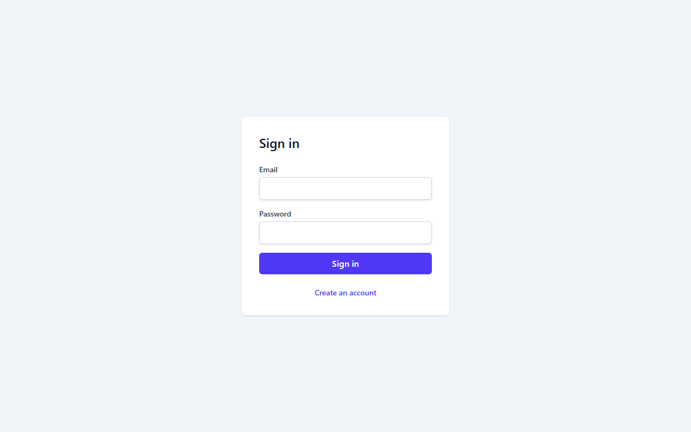
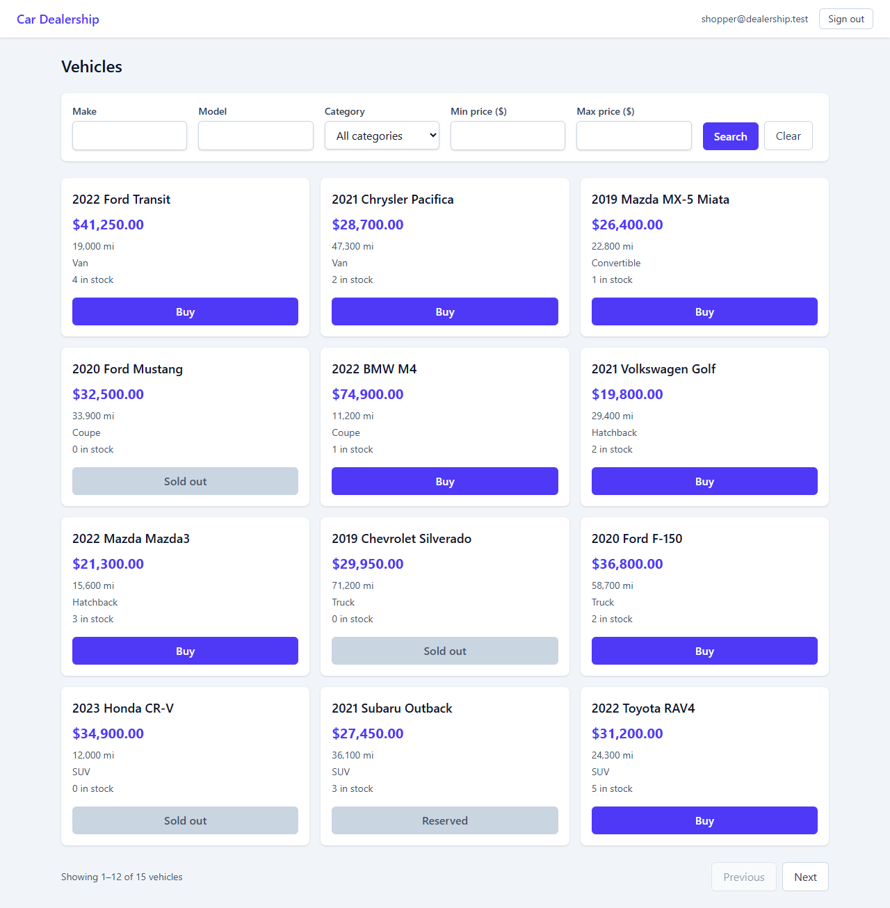
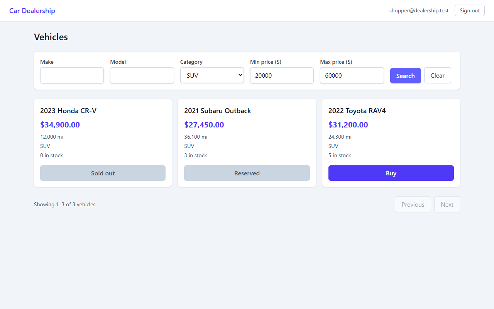
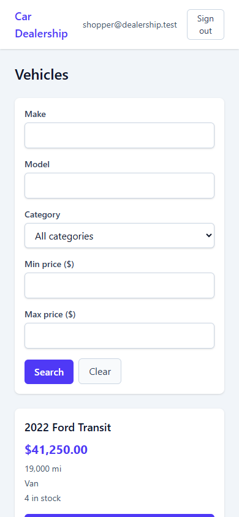
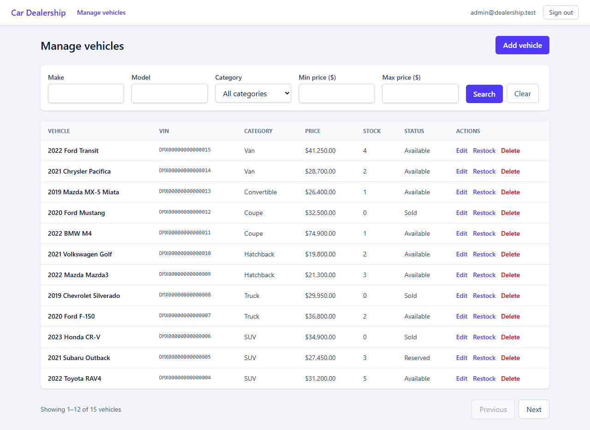
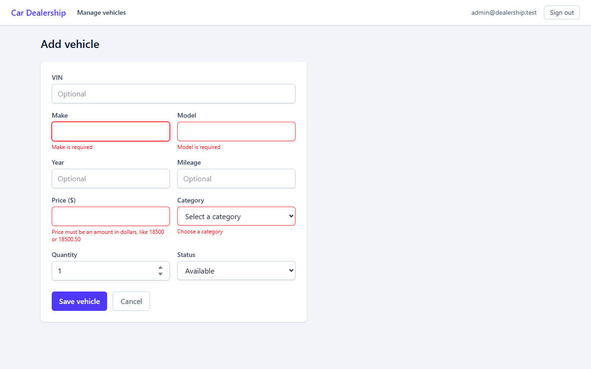

# Car Dealership Inventory System

[](https://github.com/Darkdoc0/car-dealership-inventory/actions/workflows/ci.yml)

A full-stack inventory app for a car dealership, built as a TDD kata. Shoppers sign up, search the stock and buy a vehicle;
admins add, edit, restock and delete vehicles.

- **Backend:** Node.js, TypeScript, Express 5, PostgreSQL 16, JWT authentication
- **Frontend:** React 19, TypeScript, Tailwind CSS 4, Vite
- **Tests:** Jest (backend), Vitest + Testing Library (frontend), Playwright (end to end) — 527 tests, all passing

> **Status:** feature-complete for the kata brief. Known limitations are listed [below](#known-limitations).

## Screenshots

Captured from the running app with the demo data (`npm run seed`) by `cd e2e && npm run screenshots`.

**Sign in**



**Shopper: vehicle list.** Search and filters, paging, and the Purchase button disabled for sold-out (and reserved) vehicles.



**Shopper: search by category and price range**



**On a phone** (390 px wide)



**Admin: vehicle table** with Edit, Restock and Delete



**Admin: add-vehicle form** showing validation errors




## Features

**Shoppers**
- Register and sign in (JWT, 1 hour)
- Search by make, model, category and price range; 12 vehicles per page
- Buy a vehicle: stock goes down by one; the button is disabled and reads "Sold out" at zero stock and "Reserved" for reserved cars
- If two shoppers race for the last unit, exactly one wins and the other sees "Not enough stock available"

**Admins** (a regular user cannot reach these screens or endpoints)
- Add a vehicle with full validation (VIN, year, mileage, price, category, starting stock)
- Edit a vehicle (only changed fields are sent; stock is read-only there)
- Restock (adds units; a sold-out vehicle becomes available again) and delete (with in-place confirmation)

## Quick start

### Prerequisites

| Tool | Version used | Notes |
|------|--------------|-------|
| Node.js | 24.14 | developed and tested on this version only |
| PostgreSQL | 16 | running on `localhost:5432` |
| Google Chrome | any recent | only for the end-to-end tests (`E2E_CHANNEL=msedge` uses Edge instead) |

### 1. Create the databases

```sql
CREATE DATABASE car_dealership;
CREATE DATABASE car_dealership_test;
```

> **`car_dealership_test` is wiped** (its `public` schema is dropped) by the backend test suite and by the end-to-end run. Never point `TEST_DATABASE_URL` at data you want to keep. Both refuse to run unless the URL ends in `car_dealership_test`.

### 2. Backend

```bash
cd backend
npm install
cp .env.example .env        # Windows PowerShell: Copy-Item .env.example .env
# edit .env: replace the <placeholders> (database password, a JWT_SECRET)
npm run seed                # resets the database and loads the demo users and vehicles (see below)
npm run dev                 # API on http://localhost:3000
```

The server also applies any pending migrations when it starts.

### 3. Frontend

```bash
cd frontend
npm install
npm run dev                 # http://localhost:5173
```

The dev server forwards `/api` to the backend on port 3000, so the browser only ever talks to one origin and no CORS setup is needed. To change the port or the backend address, copy `frontend/.env.example` to `frontend/.env` (optional).

Open <http://localhost:5173> and sign in with one of the [demo logins](#demo-data-and-logins).

### Demo data and logins

`npm run seed` (in `backend/`) **resets the database named in `DATABASE_URL`**: it drops everything in it, re-applies the migrations, and creates:

- one admin and one normal user (below)
- 15 vehicles across all seven categories: 11 in stock, 1 reserved (shows a disabled "Reserved" button) and **3 sold out at quantity 0** (a disabled "Sold out" button)

| Role | Email | Password | Can |
|------|-------|----------|-----|
| Admin | `admin@dealership.test` | `Admin-Passw0rd!` | everything a shopper can, plus the **Manage vehicles** screens (add, edit, restock, delete) |
| Shopper | `shopper@dealership.test` | `Shopper-Passw0rd!` | search and buy vehicles |

These logins are public and for **local development only**. The seed prints them when it finishes, and it refuses to run when `NODE_ENV=production` or when the database name contains `prod` or `prd`, so they cannot be created on a real deployment. Run it again at any time to get back to this exact starting state (for example after trying out purchases).

If you want an empty database with only your own admin instead, use `npm run seed:admin`, which reads `ADMIN_EMAIL` and `ADMIN_PASSWORD` from `backend/.env` and does not delete anything.

## Configuration

`backend/.env` (copy of `backend/.env.example`; the real file is git-ignored):

| Variable | Purpose |
|----------|---------|
| `DATABASE_URL` | PostgreSQL connection string for the app |
| `TEST_DATABASE_URL` | Connection string for `car_dealership_test` (wiped by the tests) |
| `PORT` | API port, default `3000` |
| `JWT_SECRET` | Signs login tokens. In production (`NODE_ENV=production`) it must be at least 32 characters or the server refuses to start |
| `ADMIN_EMAIL`, `ADMIN_PASSWORD` | Used only by `npm run seed:admin`. Re-running it promotes an existing user with that email and resets their password. `npm run seed` ignores them and uses the fixed [demo logins](#demo-data-and-logins) |

`frontend/.env` (optional; copy of `frontend/.env.example`): `PORT` (default `5173`) and `API_PROXY_TARGET` (default `http://localhost:3000`). A real environment variable overrides the file. Neither value is a secret.

Both `.env.example` files contain only placeholders or defaults; the real `.env` files are git-ignored.

### Production build

```bash
cd backend  && npm run build && NODE_ENV=production npm start
cd frontend && npm run build        # static files in frontend/dist
```

The backend does not serve the frontend. Host `frontend/dist` behind a reverse proxy that serves the files and forwards `/api` to the backend on the same origin (the API has no CORS configuration). If the proxy sits in front of the API, set Express's `trust proxy` first, otherwise the login rate limiter sees every user as one address.

## API

All endpoints are under `/api`. Errors are `{ "error": "message" }`. Endpoints marked 🔒 need `Authorization: Bearer <token>`.

| Method and path | Who | Description |
|-----------------|-----|-------------|
| `POST /auth/register` | anyone | `{ email, password }` → `201 { id, email }`. Password 8 characters to 72 bytes; email is case-insensitive and unique (`409`) |
| `POST /auth/login` | anyone | → `{ token, user }`. Same `401` for an unknown email and a wrong password; 10 failed attempts per IP per 15 minutes, then `429` |
| `GET /auth/me` 🔒 | any user | `{ id, email, role }` |
| `GET /admin/users` 🔒 | admin | All users (`403` for others) |
| `GET /vehicles` 🔒 | any user | Filters `make`, `model`, `category`, `status`, `minYear`, `maxYear`, `minPrice`, `maxPrice` (dollars, e.g. `19999.99`), `limit` (1–100, default 20), `offset`. Newest first. → `{ items, total, limit, offset }` |
| `GET /vehicles/search` 🔒 | any user | The same filters as the list (search by make, model, category or price range); returns the same paged shape, not a bare array |
| `GET /vehicles/:id` 🔒 | any user | One vehicle, or `404` |
| `POST /vehicles` 🔒 | admin | Create. Needs only `make`, `model`, `category` and `price`. `409` if the VIN exists |
| `PUT /vehicles/:id` 🔒 | admin | Change any subset of fields (a partial update, not a full replace); `null` clears `vin`, `year` or `mileage`. `PATCH` does the same |
| `DELETE /vehicles/:id` 🔒 | admin | `204` |
| `POST /vehicles/:id/purchase` 🔒 | any user | Optional `{ quantity }` (default 1). One atomic statement checks stock and decrements it, so concurrent buyers cannot oversell. Buying the last unit marks the car `sold`. `409` if there is not enough stock or the car is not `available` |
| `POST /vehicles/:id/restock` 🔒 | admin | `{ quantity }` (1–1,000,000). A `sold` car becomes `available`. `409` past 1,000,000 units |

**Vehicle fields:** `make`, `model`, `price` (dollars, at most two decimals, up to 20,000,000; `priceCents` is the same amount in whole cents and is accepted and returned too, and must agree if both are sent), `category` (`sedan`, `suv`, `truck`, `hatchback`, `coupe`, `convertible`, `van`), `quantity` (0 to 1,000,000; default 1), `status` (`available`, `reserved`, `sold`; default `available`), and the optional `vin` (17 characters, letters and digits except I, O and Q, stored upper-case; unique when present), `year` (1886 to next year) and `mileage` (0 to 10,000,000), which are `null` when not set.

The original path `/api/cars` still works and serves exactly the same routes as `/api/vehicles` (an alias kept for existing callers).

## Project structure

```
backend/    Express API
  src/routes/        HTTP only: parse input, call a repository, map results to status codes
  src/cars/          schemas.ts (validation) and carRepository.ts (all SQL for cars, behind an interface)
  src/users/         userRepository.ts (all SQL for users)
  src/middleware/    requireAuth (JWT + user lookup) and requireRole
  src/demoData.ts    the demo users and 15 vehicles, and the guarded reset behind npm run seed
  migrations/        numbered .sql files, applied once each inside a transaction
  tests/             Jest + Supertest against a real PostgreSQL
frontend/   React app
  src/api/           typed API client (no React) and the ApiError type
  src/auth/          session, token storage, AuthProvider, password rules
  src/cars/          search hook, filters, list/card/form components
  src/pages/         one component per screen
e2e/        Playwright tests; starts its own backend (:3101) and frontend (:5174)
docs/       TEST_REPORT.md and TDD_EVIDENCE.md
PROMPTS.md  raw AI chat log (see "My AI Usage")
```

Design choices worth knowing:

- **Layering and dependency injection.** Routes depend on repository interfaces, and `createApp({ dependencies })` accepts fakes, so the HTTP layer is tested with no database. The frontend does the same with an `ApiClient` interface.
- **Money is whole cents internally** (never floats). The API takes and returns `price` in dollars (checked to at most two decimals) beside `priceCents`.
- **The server is the authority.** The frontend validates with the same rules for fast feedback, but every rule is enforced again by the API and, for the important ones, by database `CHECK` constraints.
- **No oversell.** Stock changes are single conditional `UPDATE`s, proven by a 10-way concurrency test and a two-browser end-to-end test.
- **Stock is not editable in the edit form.** It changes only through restock and purchase, so an admin saving a stale form cannot overwrite sales made in the meantime.

## Testing

```bash
cd backend  && npm test                  # 303 tests; add :coverage for the coverage table
cd frontend && npm test                  # 201 tests; add :coverage for the coverage table
cd e2e      && npm install && npm test   # 23 browser tests, about 45 seconds
cd e2e      && npm run report            # open the HTML report (traces and screenshots of failures)
```

Run the three suites one after another, not at the same time: they share `car_dealership_test`.

The full results — per-suite coverage, the end-to-end scenario table, a check that the tests really fail when the app is broken, and known gaps — are in [`docs/TEST_REPORT.md`](docs/TEST_REPORT.md).

## Known limitations

- Purchases are not recorded: there is no orders table, so there is no purchase history or receipt.
- Login throttling is per IP and held in memory (it resets on restart and is not shared between instances).
- The session token is kept in `localStorage`, and logging out only forgets it locally: the backend has no token revocation, so a copied token works until it expires (1 hour).
- The category and status lists exist in three places (database, API schema, frontend); adding a category means editing all three.
- The frontend is not served by the backend (see [Production build](#production-build)).
- There is no CI workflow; the suites run locally.
- The end-to-end tests cover Chrome only. There are no load tests or automated accessibility audit.

## My AI Usage

This project was built with **Claude** (Anthropic): the kata brief was written in a claude.ai chat, and all implementation was done in the Claude Code desktop app with Claude Sonnet 5.5. **GitHub Copilot was not used.** Claude wrote essentially all of the code, tests, migrations and documentation; I directed it and decided what to do next.

**How the work was run**

- **Phased plan, one approval at a time.** The brief set four phases (setup, backend, frontend, deliverables). I answered "yes, do X next" at each step, and Claude did not push, open pull requests or change the PR description without that go-ahead.
- **Strict red-green-refactor.** For each behavior Claude wrote a failing test, watched it fail for the right reason, committed it on its own, then wrote the minimum code to pass. 42 of the 110 commits behind the two pull requests are `test:` commits, and each failing-test commit sits directly before its implementation commit. Refactors are separate `refactor:` commits with no behavior change and unchanged tests. PRs #1 and #2 were squash-merged, so `main` shows each as one commit; the un-squashed history of PR #2 and PR #3 is merged into `main` (so `git log` shows their red-green pairs), and PR #1's stays behind its pull request. [`docs/TDD_EVIDENCE.md`](docs/TDD_EVIDENCE.md) lists every test commit next to the commit that implements it (with links) and shows how to replay a pair yourself.
- **A code review before every implementation commit.** Claude ran a code-review pass on each change and reported its findings. Many were fixed immediately, test-first: for example login accepted passwords longer than 72 bytes (bcrypt ignores the rest, so a longer string matched), a transient `/me` failure wiped a valid session, paging unmounted the Next button and dropped keyboard focus, and the edit form kept the previous vehicle when the id in the address changed. Findings not fixed were recorded in the PR description.
- **A whole-codebase review.** After the backend was done, a SOLID and clean-code review of all of `backend/` led to seven separate refactor commits (user repository, injectable app, password hasher, one error helper, typed domain values, declarative filters, testable startup with graceful shutdown). A final audit before submission added security headers (helmet) and a minimum production JWT secret length.
- **Every commit carries the co-author trailer**, added by a git hook: `Co-authored-by: Claude <AI@users.noreply.github.com>`. The hook lives in `.githooks/` and git only uses it once you run `git config core.hooksPath .githooks` in a clone (set `NO_AI=1` for a commit written entirely by hand). The prompt logger is configured in `.claude/settings.json` and runs automatically inside Claude Code. GitHub maps that address to an unrelated account called "ai", so the repository's Contributors list shows it; no one else worked on this project.

**How the output was verified rather than trusted**

- Coverage was measured and the gaps closed with real tests (backend 100%, frontend 99.6%).
- The application was run in a real browser against the real backend several times (register, search, buy, add, restock, delete).
- The end-to-end suite was checked by deliberately breaking the app (a UI label, then the purchase stock guard) and confirming the tests failed; one of those breaks went *un*noticed by the browser tests (the backend suite covers it), and the report says so.
- The end-to-end tests found a real bug the unit tests had missed: pressing Search with unchanged filters sent no request.

**Where the AI got things wrong** (found by tests, review or running the app, then fixed)

- It installed TypeScript 7, which `ts-jest` does not support, and had to pin version 5.
- It named a React component `CarForm.tsx` beside a helper `carForm.ts`; the two differ only in letter case, which Windows treats as one file. Renamed.
- It seeded test cars with VINs containing the letter I, which the API correctly rejected.
- A few commands ran in the wrong directory (so a test run picked up the wrong suite, and two stray empty folders were left behind until the final audit). A few shell commands mangled template strings and wrote broken files; most were caught before committing, but one reached a commit and was repaired in the next one (`fix(frontend): restore the car fake's VIN template literal`).
- It first described the frontend's uncovered lines from memory and got two wrong; checking the code revealed two untested behaviors, which now have tests.

**My reflection (in my own words)**

AI saved me a lot of time: setting up Express and React, writing several drafts of the tests, and even fixing my forgotten Postgres password. I really liked the idea of TDD. It is much more systematic, and the review step before each implementation commit made me confident I was on the right path.

The one thing I got stuck on was connecting GitHub. The connector was broken, so I had to use the GitHub CLI instead. At one point Claude also told me the GitHub and Playwright plugins were not installed when they were. It made me work very fast, but I still had to check and review manually that everything worked properly.

**Limits of this record.** [`PROMPTS.md`](PROMPTS.md) is the raw chat log, written by a hook (`.claude/hooks/log-prompts.mjs`). The kata brief itself was written in claude.ai before the hook existed and is pasted at the top. The hook did not capture every turn of the later session, so 11 prompts and 14 replies were **backfilled** afterwards from the Claude Code session transcript. Each backfilled entry is labelled `(backfilled from the session transcript)` in the file, they sit in time order among the live entries, and the live entries were not altered. Two caveats: a reply is recorded as the final message of its turn (as the hook does), not the intermediate tool calls and test output; and the author's local database password, which appeared in the log twice, was replaced with `[REDACTED-DB-PASSWORD]` (the password still exists in the git history of the two merged pull-request branches, not on `main`. It only protects a PostgreSQL server on the author's own machine, which is not reachable from the internet, and it is not used anywhere else, so the author chose not to rotate it). The public share link for the claude.ai chat where the brief was written is at the top of `PROMPTS.md`: <https://claude.ai/share/22be8431-e2b2-4e81-b1ae-a19df5e7036f>.
